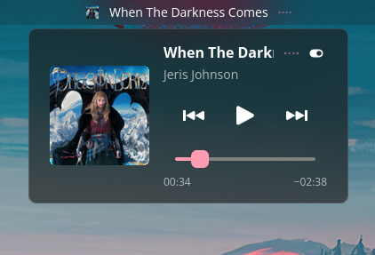
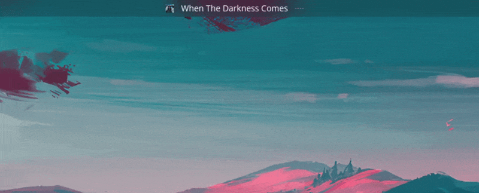

# Saisei

A now-playing applet for the [COSMIC™](https://github.com/pop-os/cosmic-epoch) desktop panel, with a card like Now Playing in the macOS menu bar.

*Saisei* (再生) is Japanese for "playback", the word on Japanese play buttons.

<table>
  <tr>
    <td align="center"></td>
    <td align="center"></td>
  </tr>
</table>

## Features

- **What's playing, in the panel** - the song's cover, its title, and bars that dance in your accent color while it plays
  - A paused song stays for 5 minutes, then the applet goes back to its icon
- **A Now Playing card** - click the applet for a large cover, the title and artist, previous, play/pause and next, and the song's progress with the time played and the time left
  - Drag the progress bar to jump anywhere in the song
  - Click the cover to bring the player's window up
  - Titles and artists too long to fit scroll instead of being cut short
- **Any MPRIS player** - Spotify, browsers, VLC, mpv, Rhythmbox, Elisa and more
  - With more than one player open, pick which one the card shows; a player that starts playing takes over by itself
- **Covers from anywhere** - local files, web addresses, and Flatpak browsers that keep their covers inside their sandbox
  - Wide video thumbnails are cropped square, and covers stay put while browsers replace their cover files
- **Middle-click** the applet to play or pause without opening it
- **Drawn in your COSMIC theme** - its colors, corners and spacing, in light and dark

## Localization

Saisei is available in English and Brazilian Portuguese.

To add a language, copy `i18n/en/cosmic_applet_saisei.ftl` into a new locale directory under `i18n/` (for example `i18n/de/`), and translate the value to the right of each `=`, leaving the keys unchanged.

Song titles, artists and player names come from the player and keep their own wording.

## Installation

### NixOS

Saisei's flake provides a package and a NixOS module. In your system flake:

```nix
inputs.cosmic-applet-saisei = {
  url = "github:KemonoElite/cosmic-applet-saisei";
  inputs.nixpkgs.follows = "nixpkgs";
};
```

Then add the module to your host and turn it on:

```nix
modules = [
  inputs.cosmic-applet-saisei.nixosModules.default
  { programs.cosmic-applet-saisei.enable = true; }
];
```

Rebuild, and update it later with `nix flake update cosmic-applet-saisei`.

To try it without installing:

- Build: `nix build github:KemonoElite/cosmic-applet-saisei`
- Development shell: `nix develop`

### From source

Requires Rust 1.95 or newer, [just](https://github.com/casey/just), and the `pkg-config`, `libxkbcommon-dev`, `libwayland-dev` and `libegl-dev` system dependencies. Covers that players give as web addresses are fetched with `curl`.

- Install: `just build-release && sudo just install`
- Install for your user only: `just build-release && just prefix=$HOME/.local install`
- Uninstall: `sudo just uninstall` (or `just prefix=$HOME/.local uninstall`)

## Usage

1. Open **Settings → Desktop → Panel → Applets**
2. Add **Saisei**, best in the middle of the top panel
3. Play something in any app: it shows up in the panel
4. Click the applet to open the card; middle-click it to play or pause

## Configuration

Click the toggle in the card's top-right corner to open **Customize**, and choose what the applet shows in the panel:

- **Cover** - the song's cover
- **Song title** - the title, up to about 240 pixels wide
- **Animated bars** - the bars that move while it plays

With all three off, the applet shows a music note while something plays.

Settings are kept by COSMIC in `~/.config/cosmic/dev.cosmic_ext.CosmicAppletSaisei/v1/`, as the files `show_cover`, `show_title` and `show_bars`, each holding `true` or `false`. A change made in one panel shows in every other.

## Troubleshooting

### Saisei isn't in the list of applets

- Make sure it's installed: `which cosmic-applet-saisei` should print a path
- Log out and back in, so the panel sees the new applet

### A player doesn't show up

- The player needs to support MPRIS. Most do; in Firefox, check that `media.hardwaremediakeys.enabled` is on in `about:config`
- Check what's on the bus: `busctl --user list | grep mpris`. Saisei shows every player listed there that has a song loaded
- `playerctld` is left out on purpose: it mirrors another player, which already shows

### No cover

- Covers come from the player; some don't give one, or not for every song
- Covers given as web addresses need `curl` (the NixOS package brings its own)
- Saved covers are in `~/.cache/dev.cosmic_ext.CosmicAppletSaisei/covers/`, and it's safe to delete them at any time

### No progress bar

Live streams and radio have no length, so there's nothing to show progress against. The card shows the controls without it.

### More detail

Run it from a terminal with logging turned up, and the popup opening by itself:

```sh
COSMIC_SAISEI_PREVIEW=popup RUST_LOG=cosmic_applet_saisei=debug cosmic-applet-saisei
```

## Development

```sh
just build-debug   # build a debug version
just run           # run it with its popup open and debug logging
just check         # run clippy
```

`COSMIC_SAISEI_PREVIEW=settings` opens the popup on Customize instead.

## Packaging

Stage the install with `rootdir` and set where it will live with `prefix`:

```sh
just build-release
just rootdir="$pkgdir" prefix=/usr install
```

To build offline, `just vendor` packs the dependencies into `vendor.tar`, and `just build-vendored` builds from it.

## License

GNU General Public License v3.0 only - see [LICENSE](LICENSE). Provided as is, without warranty: use it at your own risk.

## Acknowledgments

- [cosmic-ext-applet-dynamic-island](https://github.com/DrakRosmann/cosmic-ext-applet-dynamic-island) by DrakRosmann - the applet Saisei was rewritten from
- [System76](https://system76.com/) / [libcosmic](https://github.com/pop-os/libcosmic) and [cosmic-applets](https://github.com/pop-os/cosmic-applets) - the COSMIC desktop, its UI toolkit, and the applets Saisei is laid out like
